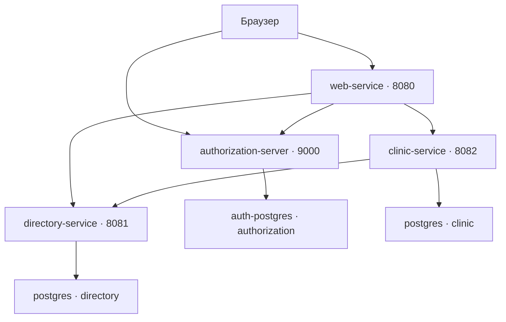

# Клиника: запись на приём и медицинские документы

Учебное приложение на Spring для взаимодействия пациентов, врачей и администратора клиники. Пациент находит специалиста, регистрируется, заполняет профиль, записывается на приём, получает заключение, оставляет отзыв и управляет своими документами. Врач просматривает назначенные приёмы и доступные медицинские записи, оформляет заключение или фиксирует неявку. Администратор управляет справочниками, просматривает записи, отменяет будущие приёмы и выгружает статистику.

Приложение состоит из четырёх самостоятельных Spring Boot-сервисов. Пользовательский интерфейс формируется на сервере с помощью Thymeleaf; HTMX используется для обновления результатов поиска. Вход организован через отдельный OAuth2/OpenID Connect Authorization Server.

## Содержание

1. [Возможности и роли](#1-возможности-и-роли)
2. [Архитектура и компоненты](#2-архитектура-и-компоненты)
3. [Технологии и структура проекта](#3-технологии-и-структура-проекта)
4. [Правила предметной области](#4-правила-предметной-области)
5. [Запуск в Docker](#6-запуск-в-docker)
6. [Настройки и переменные окружения](#7-настройки-и-переменные-окружения)
7. [Использование приложения](#8-использование-приложения)
7. [HTTP API](#9-http-api)
9. [Безопасность и аутентификация](#10-безопасность-и-аутентификация)
10. [Хранение данных и миграции](#11-хранение-данных-и-миграции)
11. [Сборка и локальная разработка](#12-сборка-и-локальная-разработка)
12. [Тестирование](#13-тестирование)
13. [Отказоустойчивость и диагностика](#14-отказоустойчивость-и-диагностика)
14. [Сохранность данных и ограничения](#15-сохранность-данных-и-ограничения)

## 1. Возможности и роли

| Роль | Возможности |
| --- | --- |
| Гость | Просмотр больниц, специальностей, врачей, расписания и свободного времени; регистрация пациента; переход ко входу |
| `PATIENT` | Создание и изменение собственного профиля; запись и отмена своих будущих приёмов; чтение собственных заключений; отзывы по завершённым приёмам; загрузка, чтение, скачивание и удаление своих документов |
| `DOCTOR` | Список назначенных приёмов; оформление заключения и завершение приёма; фиксация неявки; доступ к медицинским записям при соблюдении правил связи с пациентом и больницей; чтение отзывов о назначенных ему приёмах |
| `ADMIN` | CRUD больниц, специальностей и врачей в справочнике; просмотр административных сведений обо всех приёмах; отмена будущих записей; агрегированная статистика и CSV |

**Администратор не получает доступ к медицинскому содержимому**: роль `ADMIN` не разрешает чтение профилей пациентов через `/api/patients/me`, заключений или документов. В этой реализации администратор глобальный; отдельная привязка администратора к больнице отсутствует.

Регистрация через публичную форму всегда создаёт `PATIENT`. Роль врача или администратора нельзя выбрать полем формы. Управление справочником врачей не создаёт автоматически учётную запись, связь с `doctor_accounts` или расписание нового сотрудника.

## 2. Архитектура и компоненты



Два последних узла — разные логические базы одного контейнера `postgres`. Авторизация хранится в отдельном контейнере `auth-postgres`. Прямых SQL-запросов из одного сервиса в базу другого сервиса нет: взаимодействие прикладных компонентов выполняется по HTTP.

| Компонент | Ответственность | Собственные данные |
| --- | --- | --- |
| `web-service` | Серверный интерфейс, формы, HTMX, вызовы API, OAuth2-клиент, обработка пользовательских ошибок, CSV | HTTP-сессии и OAuth2 authorized client в памяти процесса; собственной БД нет |
| `authorization-server` | Учётные записи, проверка паролей, регистрация пациентов, Authorization Code + PKCE, OIDC, выпуск/обновление токенов, JWK | База `authorization`: `accounts`, зарегистрированные OAuth-клиенты, авторизации, согласия; файл RSA-ключа PKCS12 |
| `directory-service` | Публичный справочник больниц, специальностей и врачей; фильтрация; административное редактирование | База `directory`: `hospitals`, `specialties`, `doctors`, `doctors_specialties` |
| `clinic-service` | Профили, привязки врачей, расписания, доступность, запись, результаты приёмов, заключения, отзывы, документы и статистика | База `clinic` и приватное файловое хранилище документов |

`web-service` выполняет роль BFF — серверного адаптера для браузера. Браузер работает с HTML и сессионной cookie; BFF получает access token и добавляет `Authorization: Bearer ...` при вызовах защищённых API. Токены не требуется хранить в JavaScript или `localStorage`.

### Адреса локального стенда

| Назначение | Адрес с компьютера пользователя | Адрес внутри Compose |
| --- | --- | --- |
| Интерфейс | `http://127.0.0.1:8080` | `http://web-service:8080` |
| Вход и issuer | `http://127.0.0.1:9000` | Сетевые вызовы: `http://authorization-server:9000` |
| Справочник | `http://127.0.0.1:8081` | `http://directory-service:8081` |
| Клиническое API | `http://127.0.0.1:8082` | `http://clinic-service:8082` |
| Основной PostgreSQL | `127.0.0.1:5432` | `postgres:5432` |
| PostgreSQL авторизации | Порт на хост не опубликован | `auth-postgres:5432` |

Все опубликованные порты привязаны к `127.0.0.1`. Это конфигурация для локального стенда. Адрес issuer в JWT остаётся **`http://127.0.0.1:9000`**, даже когда проверяющий JWT сервис запущен в контейнере. JWK, token endpoint и userinfo BFF получает по внутренним адресам. `localhost`, `127.0.0.1` и имя Docker-сервиса нельзя произвольно подменять друг другом в OAuth-настройках.

## 3. Технологии и структура проекта

Версии ниже взяты из POM, Dockerfile и Compose, а не из списка последних доступных релизов.

| Технология | Использование |
| --- | --- |
| Java 25 | Исходники, компиляция и runtime |
| Spring Boot 3.5.16 | Родитель каждого из четырёх Maven-проектов |
| Spring MVC / embedded servlet container | HTTP API и серверные контроллеры страниц |
| Spring Security, OAuth2 Client, Resource Server | Вход BFF, проверка JWT, роли и защита HTTP-запросов |
| Spring Authorization Server | OAuth2/OIDC; версия управляется родителем Spring Boot |
| Thymeleaf, Spring Security Extras | HTML и элементы интерфейса с учётом роли |
| HTMX 2.0.10, WebJars | Поиск врачей без полной перезагрузки; библиотека поставляется вместе с приложением |
| Spring Data JPA / Hibernate | Клиническая БД и справочник; DTO и EntityGraph для чтения связей |
| Spring JDBC / JdbcClient | Учётные записи и JDBC-персистентность OAuth |
| Jakarta Bean Validation | Валидация входных DTO и форм |
| Flyway | Версионируемые изменения схемы и repeatable-скрипты начальных данных |
| PostgreSQL | Схема, FK/уникальные ограничения, транзакции и блокировки |
| Resilience4j 2.3.0 | Ограниченный retry и circuit breaker для чтения справочника |
| Java ImageIO, SHA-256, NIO | Проверка изображений, контроль целостности и приватное файловое хранилище |
| Actuator | HTTP health endpoints |
| JUnit 5, Mockito, AssertJ, Spring Test / MockMvc | Модульные и HTTP-тесты |
| Testcontainers | Интеграционные тесты с отдельным PostgreSQL |
| Maven 3.9.11 / Eclipse Temurin 25 Alpine | Образы сборки Docker; runtime — `eclipse-temurin:25-alpine` |
| Docker Compose | Четыре приложения, две БД и контейнер инициализации ключа |

### Каталоги

| Путь | Содержимое |
| --- | --- |
| `web-service/` | POM, Dockerfile, Java-код BFF, Thymeleaf, CSS/JS и тесты |
| `authorization-server/` | POM, Dockerfile, код OAuth2/регистрации, шаблоны входа, SQL и тесты |
| `directory-service/` | POM, Dockerfile, справочник, SQL и тесты |
| `clinic-service/` | POM, Dockerfile, бизнес-правила клиники, хранилище, SQL и тесты |
| `docker-compose.yaml` | Единственная поставленная конфигурация всего стенда |
| `scripts/init-databases.sh` | Создание баз/пользователей `directory` и `clinic` при первой инициализации основного PostgreSQL |
| `.env.auth.example` | Пример параметров авторизации |
| `.env.auth` | Локальные значения секретов; не следует публиковать вместе с проектом |

Типичное разделение Java-кода: `controller` → `service` → `repository`; внешние HTTP-адаптеры в `client`, преобразование сущностей в `mapper`, входные/выходные структуры в `dto`, конфигурация в `configuration`/`security`. У клиники дополнительно выделен `storage`, у BFF — `view`, `validation`, `resilience`.

## 4. Правила предметной области

### 4.1. Учётная запись и профиль

Учётная запись авторизации и профиль пациента — разные сущности. После регистрации пациент входит в систему и отдельно создаёт профиль: имя, фамилия, необязательное отчество, дата рождения. Имя/фамилия — до 100 символов, дата рождения — раньше текущей даты. Контактный телефон в DTO не предусмотрен.

Аккаунт определяется UUID из JWT `sub`. Для операций пациента сервер использует `/api/patients/me`: идентификатор владельца не выбирается произвольным полем формы. Один аккаунт может иметь только один профиль — это защищено уникальным ограничением БД. Если профиль ещё не создан, создание записи на приём или загрузка документа требуют сначала пройти заполнение профиля.

Email при регистрации нормализуется; разрешён ASCII-адрес до 255 символов. Пароль — **12–64 Unicode code points и не более 72 байт UTF-8**. Пароль не обрезается и не нормализуется как email. Публичная регистрация не выполняет автоматический вход и не создаёт клинический профиль.

### 4.2. Справочник

Врач связан с одной больницей и набором специальностей. Поиск поддерживает `hospitalId` и несколько `specialtyIds`.

- Выбранные специальности объединяются по правилу **«любая из выбранных»**.
- Условие больницы применяется совместно с фильтром специальностей.
- Врач не должен дублироваться в результатах при совпадении нескольких специальностей.
- Список врачей сортируется по фамилии, имени и ID; в DTO возвращаются больница и полный список специальностей.
- `DoctorRepository` использует EntityGraph для связанных данных; JPA open-in-view отключён.

Удаление больницы, на которую ссылаются врачи, ограничено FK. Удаление специальности удаляет её строки связи с врачами, но сохраняет самих врачей. Поэтому после такого удаления существующий врач может остаться без специальностей. Создание нового врача через API требует непустой набор специальностей.

### 4.3. Расписание и запись

Единый часовой пояс клинических расчётов — **UTC+03:00**, длительность приёма — **30 минут**. Начальные расписания врачей 1 и 2: понедельник–пятница, 09:00–17:00. Публичный API позволяет читать расписание; отдельного UI/API редактирования недельных смен нет.

Период записи рассчитывается по текущему времени сервера:

- Нижняя граница — **00:00 следующего дня в UTC+03:00**.
- Верхняя граница — **текущий момент + 14 суток**; это не конец четырнадцатого календарного дня.
- Границы включаются по времени **начала** слота.
- Слот обязан попадать в рабочую смену; его окончание не выходит за конец смены. Из ответа availability исключаются занятые неотменёнными приёмами старты; окончательную защиту от гонки всё равно обеспечивает БД.

Например, при серверном времени 3 ноября 18:00 UTC+03:00 нижняя граница — 4 ноября 00:00, верхняя — 17 ноября 18:00. В расписании 09:00–17:00 первым подходящим временем будет рабочий слот, а не обязательно полночь.

Запись проходит проверку профиля, врача, расписания и окна доступности. Частичный уникальный индекс `uk_appointments_reserved_slot` по врачу и началу не допускает две неотменённые записи на один слот. При конкуренции одной из сторон возвращается `409 Conflict`. Пересечение записей одного пациента **к разным врачам** отдельно не запрещено.

Статусы:

| Код | Подпись | Значение |
| --- | --- | --- |
| `BOOKED` | Запланирован | Создана активная запись |
| `CANCELLED` | Отменён | Запись отменена, слот освобождён |
| `COMPLETED` | Завершён | Врач отправил итоговое заключение |
| `NO_SHOW` | Неявка | Врач зафиксировал отсутствие пациента |

Пациент-владелец или администратор может отменить `BOOKED` **до начала**. Повторная разрешённая отмена уже отменённой записи не меняет первоначальные поля аудита. Врач не отменяет приём. Автоматического перевода просроченной `BOOKED` в другой статус нет.

### 4.4. Заключение, неявка и отзыв

Назначенный врач может оформить итог **в момент окончания приёма или позже**. При этом проверяется и больница записи относительно текущей больницы врача.

- Отправка заключения в одной транзакции переводит запись в `COMPLETED` и сохраняет заключение.
- `findings`, `diagnosis`, `recommendations` обязательны, каждое поле — до 10 000 символов.
- Опубликованное заключение нельзя редактировать или удалять через имеющийся API.
- Фиксация `NO_SHOW` не создаёт заключение.
- Пациент может создать один отзыв на собственный `COMPLETED`: оценка 1–5 и необязательный текст до 2 000 символов. Отзыв можно изменить или удалить.
- Другой врач/пациент не получает доступ лишь потому, что знает UUID записи.

### 4.5. Правила чтения медицинских данных

Пациент читает только свои данные. Для чтения медицинской истории врач должен быть связан с пациентом приёмом в **текущей больнице врача**: либо `COMPLETED`, либо будущая `BOOKED`, у которой начало строго позже текущего времени. Отменённая запись, `NO_SHOW` или уже начавшаяся незавершённая запись сами по себе доступа не дают.

Для заключений дополнительно учитывается историческая больница конкретного приёма: врач не получает заключения из другой больницы. **Документы принадлежат пациенту**, у каждого файла нет отдельного поля больницы; после успешной проверки медицинского доступа врач видит доступные документы пациента. Не следует переносить дополнительный фильтр больницы заключений на файлы.

Чтение отзыва о конкретном приёме разрешено пациенту-владельцу и назначенному врачу по отдельной проверке назначения. Администратор медицинские данные не читает. Для сокрытия существования чужих ресурсов бизнес-проверки часто возвращают `404`, а не подтверждают существование ресурса ответом с его подробностями.

### 4.6. Документы

Поддерживаются PDF, PNG и JPEG (`.jpg`/`.jpeg`). Максимальный размер файла — **5 МиБ = 5 242 880 байт**, максимальный multipart-запрос — 6 МиБ. На загрузку передаётся ровно одна часть `file`.

Проверки включают имя до 200 символов с NFC-нормализацией, запрет путей/двоеточий/управляющих символов, соответствие расширения и MIME, сигнатуры формата, ограниченное чтение байтов. Изображения декодируются; число пикселей не должно превышать 20 000 000. PDF проверяется по сигнатуре/завершающему маркеру; это не полная семантическая проверка PDF и не антивирусная проверка.

Метаданные хранятся в `patient_documents`, байты — отдельно:

- `staging/<UUID>.part` — промежуточная запись;
- `objects/<UUID>.bin` — активный объект;
- исходное имя используется для отображения/скачивания, но не как путь на диске;
- чтение проверяет размер и SHA-256;
- используются ограничения на символьные ссылки, атомарное перемещение и приватные POSIX-права там, где они поддерживаются.

Жизненный цикл: `STAGED` → `READY` → `DELETE_PENDING` → удаление. При неудачной загрузке/удалении механизм очистки повторяет удаление отложенных и осиротевших объектов. Это согласование файловой системы и БД, а не распределённая транзакция между ними.

Скачивание выполняется после авторизации, как attachment, с `no-store`, `nosniff` и sandbox CSP. Файлы не публикуются как статические ресурсы. **В поставленном Compose отдельного тома документов нет** — необходимое дополнение описано ниже.

### 4.7. Статистика и CSV

Статистика доступна глобальному администратору. Она группирует приёмы по врачу, **исторической больнице на момент записи** и текущему статусу. Фильтрация выполняется по началу приёма:

`[from 00:00 UTC+03:00, to 00:00 UTC+03:00)`.

`to` не включается. Допускается период 1–366 дней в пределах 1900-01-01…9999-12-31, необязательные положительные `doctorId` и `hospitalId`. По умолчанию UI показывает сегодня и предыдущие 29 дней. Больше 10 000 групп отклоняется с предложением сузить запрос — усечённый результат не выдаётся.

Это количество приёмов по текущему состоянию, **не расчёт отработанных часов или выручки**. Учитываются все статусы. Отменённый приём относится к исходной дате начала, а не к дате отмены.

CSV формирует BFF из проверенного DTO: UTF-8, CRLF, колонки `from_inclusive,to_exclusive,timezone,doctor_id,hospital_id,status,count`. Коды статусов и заголовки остаются техническими английскими. В CSV нет ФИО, медицинского содержимого или произвольных текстовых названий, которые могли бы интерпретироваться таблицей как формулы. Просмотр страницы и скачивание — разные запросы; при изменении записей между ними цифры могут отличаться.

## 5. Запуск в Docker

### 5.1. Требования

Нужны Docker Engine/Docker Desktop с работающим daemon, Docker Compose v2, свободные порты 8080/8081/8082/9000/5432 и доступ к Maven-/Docker-репозиториям. Для предлагаемых команд с `--wait` нужна версия Compose, поддерживающая этот параметр. Bash/OpenSSL полезны для подготовки локальных секретов; curl — для проверок.

**При Docker-сборке отдельный установленный на хосте JDK/Maven не обязателен**: они находятся в build-образах. Для тестов на хосте требования отдельные — раздел 13.

Откройте терминал в корне проекта — рядом с `docker-compose.yaml`. Сначала проверьте/устраните пункты раздела 5.

### 5.2. Подготовить окружение

В архиве есть `.env.auth.example` и локальный `.env.auth`. Если у вас уже есть работающий стенд с БД и ключами, **сохраните его значения**. Не перегенерируйте пароли поверх существующего `auth_data`/`auth_keys` ради повторного запуска.

Для новой среды можно скопировать пример и заполнить три параметра:

```bash
cp -n .env.auth.example .env.auth
```

Обязательные значения: `AUTH_DB_PASSWORD`, `KEYSTORE_PASSWORD`, `CLIENT_SECRET`. Последний должен содержать не менее 16 символов и совпадать у BFF и сервера авторизации. Используйте собственные случайные значения.

### 5.3. Проверить и запустить

```bash
# Проверяет Compose без вывода интерполированных секретов.
docker compose --env-file .env.auth config --quiet

# Проверка загрузки указанных инфраструктурных образов.
docker compose --env-file .env.auth pull postgres auth-postgres auth-key-init

# Собрать и запустить приложения и зависимости.
docker compose --env-file .env.auth up -d --build

# Состояние контейнеров.
docker compose --env-file .env.auth ps -a
```

Если healthchecks согласованы, можно сразу дождаться готовности:

```bash
docker compose --env-file .env.auth up -d --build --wait --wait-timeout 240
```

Для первого запуска с явным порядком:

```bash
docker compose --env-file .env.auth up -d postgres auth-postgres auth-key-init
docker compose --env-file .env.auth up -d --build authorization-server
# Дождаться health авторизации, затем:
docker compose --env-file .env.auth up -d --build directory-service clinic-service
# Дождаться health API, затем:
docker compose --env-file .env.auth up -d --build web-service
```

`auth-key-init` — одноразовый контейнер: он создаёт `signing.p12`, если его нет, и завершает работу. Для него нормален **Exited (0)**; от него не ожидается постоянный HTTP health. Ключ имеет alias `hospital-signing`, RSA 3072 при генерации Compose, хранится в `auth_keys` и монтируется в авторизацию только для чтения.

Затем откройте **http://127.0.0.1:8080**. Не открывайте HTML через `file://`: `th:href`, формы и фрагменты должны обработаться Thymeleaf на сервере.

### 5.4. Проверить HTTP

```bash
curl -fsS http://127.0.0.1:8080/actuator/health
curl -fsS http://127.0.0.1:9000/actuator/health
curl -fsS http://127.0.0.1:8081/actuator/health
curl -fsS http://127.0.0.1:8082/actuator/health

curl -fsS http://127.0.0.1:8081/api/hospitals
curl -fsS http://127.0.0.1:8081/api/specialties
curl -fsS 'http://127.0.0.1:8081/api/doctors?hospitalId=2&specialtyIds=1&specialtyIds=3'
curl -fsS http://127.0.0.1:9000/.well-known/openid-configuration
curl -fsS http://127.0.0.1:9000/oauth2/jwks
```

Ожидается `UP` у health и JSON у API. Это базовая проверка доступности, а не доказательство готовности всех пользовательских сценариев. `/actuator/info` указан в конфигурации JPA-сервисов, но явно разрешённым публичным endpoint в их Security является только health.

### 5.5. Остановка, обновление, журналы

```bash
docker compose --env-file .env.auth logs --tail=100 web-service
docker compose --env-file .env.auth logs --tail=100 authorization-server
docker compose --env-file .env.auth logs --tail=100 clinic-service

docker compose --env-file .env.auth stop
docker compose --env-file .env.auth start

# После изменения исходников/конфигурации:
docker compose --env-file .env.auth up -d --build

# Удалить контейнеры/сеть, сохранив named volumes:
docker compose --env-file .env.auth down
```

`down` сохраняет БД/ключи в named volumes, но **не обеспечивает сохранность документов, пока не выполнен пункт 5.3**. Команда `down -v` удаляет именованные тома с данными и не является обычным способом обновления. Перед намеренным сбросом делайте резервную копию и проверяйте точное имя проекта/томов; не используйте глобальную очистку Docker для исправления ошибки приложения.

## 6. Настройки и переменные окружения

### 6.1. Базы и авторизация

| Переменная | Где используется | Назначение / значение локального стенда |
| --- | --- | --- |
| `POSTGRES_URL` | auth, directory, clinic | JDBC URL собственной БД сервиса |
| `POSTGRES_USER`, `POSTGRES_PASSWORD` | auth, directory, clinic | Пользователь/пароль БД |
| `AUTH_DB_PASSWORD` | Compose auth-postgres и auth | Пароль пользователя `postgres_authorization` |
| `KEYSTORE_PASSWORD` | auth-key-init, auth | Пароль PKCS12; должен соответствовать сохранённому файлу |
| `CLIENT_SECRET` | auth и web | Секрет confidential client `hospital-web`, минимум 16 символов |
| `ISSUER` | auth | По умолчанию `http://127.0.0.1:9000` |
| `SIGNING_KEY_PATH` | auth | По умолчанию `file:./keys/signing.p12`; в Compose `file:/opt/app/keys/signing.p12` |
| `AUTH_ISSUER` | web, directory, clinic | Точный ожидаемый issuer токенов |
| `AUTH_JWK_SET_URI` | directory, clinic | На хосте по умолчанию `http://127.0.0.1:9000/oauth2/jwks`; в Compose — имя сервиса авторизации |

Основной `postgres` создаёт БД `directory`/`clinic` и пользователей `postgres_directory`/`postgres_clinic`. В текущем учебном скрипте пароль каждого такого пользователя совпадает с его именем; у основной роли `postgres` в Compose задан пароль `postgres`. Эти параметры не подходят как настройки публичного промышленного стенда.

`scripts/init-databases.sh` выполняется только при первоначальной инициализации пустого PostgreSQL volume. Изменение `POSTGRES_MULTIPLE_DATABASES` на уже созданном кластере само по себе не добавляет новую БД.

### 6.2. HTTP-связи и BFF

| Переменная | По умолчанию | Назначение |
| --- | --- | --- |
| `WEB_PUBLIC_BASE_URL` | `http://127.0.0.1:8080` | Внешний адрес web и построение OAuth callback |
| `AUTH_BACKEND_BASE_URL` | `http://127.0.0.1:9000` | Серверные token/JWK/userinfo/registration-вызовы BFF |
| `DIRECTORY_BASE_URL` | `http://127.0.0.1:8081` | Адрес справочника для web и clinic |
| `CLINIC_BASE_URL` | `http://127.0.0.1:8082` | Адрес клинического API для web |
| `WEB_CONNECT_TIMEOUT` | `1s` | Connect timeout BFF |
| `WEB_READ_TIMEOUT` | `2s` | Обычные чтения BFF |
| `WEB_DOCUMENT_READ_TIMEOUT` | `15s` | Клиент BFF для работы с документами |
| `DIRECTORY_CONNECT_TIMEOUT` | `1s` | Connect timeout clinic → directory |
| `DIRECTORY_READ_TIMEOUT` | `2s` | Read timeout clinic → directory |
| `WEB_COOKIE_SECURE` | `false` | Secure-флаг web-cookie; для HTTPS-среды требуется согласовать весь внешний URL/issuer/cookie-контракт |

Base URL BFF должны быть HTTP(S)-origin без произвольного пути/query/fragment. Текущий локальный клиент зарегистрирован для точных redirect URI, поэтому одной замены адреса в окружении недостаточно для переноса стенда на другой домен.

### 6.3. Документы

| Настройка | Значение по умолчанию | Уточнение текущей версии |
| --- | --- | --- |
| `DOCUMENT_STORAGE_ROOT` → `app.documents.root` | `./data/documents` | Применяется к DocumentProperties |
| `DOCUMENT_CLEANUP_GRACE` → `app.documents.cleanup-grace` | `PT1H` | Возраст staged/orphan-файлов перед очисткой |
| `DOCUMENT_CLEANUP_DELAY` → `app.documents.cleanup-delay` | `PT1M` | Scheduler пока читает другой префикс; см. 5.4 |
| `DOCUMENT_CLEANUP_ENABLED` → `app.documents.cleanup-enabled` | `true` | Условие включения scheduler пока использует `clinic.documents`; см. 5.4 |

В `web-service` multipart file threshold — 6 МиБ; в `clinic-service` — 0 байт. Ограничения размера файла/запроса при этом согласованы: 5/6 МиБ. Временная multipart-обработка и долговременное хранилище документов — разные механизмы.

## 7. Использование приложения

### 7.1. Начальные данные

В новой БД скрипты создают две больницы, 15 специальностей, двух врачей, четыре аккаунта и расписания врачей. Существующие аккаунты связаны следующим образом:

| Email | Роль | Связь |
| --- | --- | --- |
| `admin@example.com` | `ADMIN` | Глобальное администрирование |
| `ivanov@yandex.ru` | `DOCTOR` | Врач 1, Иван Иванов, больница 2 |
| `petrov@gmail.com` | `DOCTOR` | Врач 2, Пётр Петров, больница 1 |
| `patient@yandex.ru` | `PATIENT` | Учётная запись пациента; профиль создаётся отдельно |

UUID аккаунтов последовательно заканчиваются на `...0001`–`...0004`; связь аккаунтов врачей с ID справочника задана в `doctor_accounts`.

Пароль от всех учеток password

### 7.2. Сценарий пациента

1. Откройте `/doctors`, выберите больницу/специальности и профиль врача.
2. Зарегистрируйтесь через `/register`. После успешной регистрации перейдите ко входу.
3. Пройдите страницу авторизации на порту 9000; после callback вернитесь в приложение.
4. Заполните `/patient/onboarding`: имя, фамилию, при необходимости отчество и дату рождения.
5. Откройте доступное время врача. Выберите слот в допустимом периоде и подтвердите запись.
6. В `/patient/appointments` проверьте запись. До начала приёма её можно отменить через подтверждение.
7. В `/patient/documents` загрузите действительный небольшой PDF/PNG/JPEG; скачайте его и сравните байты. После ошибки результат сначала нужно проверить в списке.
8. После завершённого приёма прочитайте заключение и оставьте отзыв. Заключения доступны также в `/patient/reports`.

Регистрация аккаунта и создание профиля разделены: можно зарегистрироваться, закрыть браузер и закончить профиль после следующего входа. Отдельный логин-пароль не вводится в формах записи или загрузки документа.

### 7.3. Сценарий врача

1. Войдите под учётной записью, связанной с врачом справочника.
2. Откройте `/doctor/appointments` и назначенный приём.
3. При наличии медицинского доступа откройте документы/историю заключений пациента.
4. После окончания приёма отправьте итоговое заключение либо подтвердите неявку.
5. Проверьте результат на стороне пациента; повторная отправка итога не должна изменять уже завершённый приём.

Поскольку нижняя граница новых записей — завтра, весь цикл «создать запись → оформить заключение» нельзя корректно ускорить за несколько минут на обычных серверных часах. Для детерминированной демонстрации границ времени используйте `ClinicalIntegrationTest` с управляемым clock либо существующие завершённые приёмы собственной демонстрационной БД. Публичного переключателя клинического времени в приложении нет.

### 7.4. Сценарий администратора

`/admin` содержит справочники, все записи и статистику. Для CRUD используйте временные демонстрационные данные. Удаление/перенос врача справочника не переписывает исторические записи и не создаёт/меняет учётные записи в других сервисах автоматически.

В `/admin/appointments` доступны административные UUID/ID, время и статус. Медицинское содержимое не показывается. Для отмены используется тот же защищённый клинический command, а не прямое обновление БД.

В `/admin/statistics` выберите даты; конечная дата не включается. Кнопка CSV сохраняет выбранные фильтры. Таблица использует русские подписи, а технические значения файла остаются прежними.

## 8. HTTP API

API-сервисы возвращают JSON, BFF — HTML, кроме скачивания документов/CSV. В таблицах указан базовый уровень роли; бизнес-проверка владельца, назначения и больницы всё равно обязательна.

### 8.1. Авторизация — порт 9000

| Метод | Путь | Назначение |
| --- | --- | --- |
| `GET` | `/login` | Вход; для русского MVC-шаблона нужна настройка 5.5 |
| `GET` | `/api/csrf` | Токен/headerName/parameterName для анонимной регистрации и соответствующей сессии |
| `POST` | `/api/registrations` | Создание пациента с CSRF той же сессии; `201` |
| `GET` | `/.well-known/openid-configuration` | OIDC metadata |
| `GET` | `/oauth2/jwks` | Публичные JWK, не приватный ключ |
| `GET` | `/oauth2/authorize` | Authorization Code + PKCE |
| `POST` | `/oauth2/token` | Обмен кода или refresh token |
| Протокольный | `/userinfo`, `/connect/logout` | OIDC userinfo и завершение сеанса |

Тело регистрации:

```json
{
  "email": "new.patient@example.test",
  "password": "A-long-demo-password-123"
}
```

Это пример формата, не поставляемый аккаунт. Для прямого POST регистрации нужно сначала получить `/api/csrf`, сохранить cookie и использовать возвращённое `headerName`/значение токена в **той же сессии**. Отсутствие/несовпадение CSRF — `403`; существующий нормализованный email — `409`; некорректный JSON/поля — `400`. Поля `role`, `id`, `doctorId` не являются допустимым способом регистрации сотрудника.

### 8.2. Справочник — порт 8081

| Метод | Путь | Доступ |
| --- | --- | --- |
| `GET` | `/api/hospitals`, `/api/hospitals/{id}` | Публично |
| `GET` | `/api/specialties`, `/api/specialties/{id}` | Публично |
| `GET` | `/api/doctors`, `/api/doctors/{id}` | Публично; фильтры `hospitalId`, повторяемый `specialtyIds` |
| `POST` | `/api/hospitals`, `/api/specialties`, `/api/doctors` | `ADMIN`; создание `201` + Location |
| `PUT` | `/api/hospitals/{id}`, `/api/specialties/{id}`, `/api/doctors/{id}` | `ADMIN`; изменение `200` |
| `DELETE` | Те же пути отдельных ресурсов | `ADMIN`; удаление `204`, отсутствующий ресурс `404` |

Пример тела врача:

```json
{
  "firstName": "Иван",
  "lastName": "Иванов",
  "education": "Медицинский университет",
  "experienceYears": 5,
  "email": "doctor@example.test",
  "hospitalId": 2,
  "specialtyIds": [1, 3]
}
```

### 8.3. Клиника — порт 8082

| Метод | Путь | Назначение / роль |
| --- | --- | --- |
| `GET`, `POST`, `PUT` | `/api/patients/me` | Собственный профиль; `PATIENT` |
| `GET` | `/api/doctors/me` | Собственная связь аккаунта и врача; `DOCTOR` |
| `GET` | `/api/doctors/{doctorId}/schedule` | Публичное недельное расписание |
| `GET` | `/api/doctors/{doctorId}/availability?date=YYYY-MM-DD` | Публичные слоты с учётом расписания и периода записи |
| `GET` | `/api/appointments?page=0&size=20` | Записи текущего пациента/врача; все записи для `ADMIN` |
| `GET` | `/api/appointments/{id}` | Разрешённые административные сведения |
| `POST` | `/api/appointments` | Запись; `PATIENT`, ответ `201` |
| `POST` | `/api/appointments/{id}/cancel` | Отмена владельцем или `ADMIN`; `204` |
| `POST` | `/api/appointments/{id}/report` | Заключение и завершение; `DOCTOR`, `201` |
| `POST` | `/api/appointments/{id}/no-show` | Неявка; `DOCTOR`, `204` |
| `GET` | `/api/appointments/{id}/report` | Чтение разрешённого заключения |
| `GET` | `/api/patients/{patientId}/reports?page=0&size=20` | Разрешённая история заключений |
| `GET` | `/api/appointments/{id}/review` | Отзыв; владелец/назначенный врач |
| `POST`, `PUT`, `DELETE` | `/api/appointments/{id}/review` | Управление отзывом; владелец `PATIENT` |
| `POST` | `/api/documents` | Multipart `file`; владелец `PATIENT`, `201` |
| `GET` | `/api/patients/{patientId}/documents?page=0&size=20` | Разрешённый список документов |
| `GET` | `/api/documents/{id}` | Метаданные разрешённого документа |
| `GET` | `/api/documents/{id}/content` | Приватное скачивание |
| `DELETE` | `/api/documents/{id}` | Удаление владельцем; `204` |
| `GET` | `/api/admin/statistics?from=YYYY-MM-DD&to=YYYY-MM-DD` | Агрегаты; `ADMIN`; опциональные `doctorId`, `hospitalId` |

Для пагинируемых клинических коллекций размер по умолчанию 20, допустимый максимум 100. В BFF для основных страниц используется фиксированный размер 20. `patientId` в URL медицинской истории — UUID клинического профиля; его не следует путать с UUID аккаунта из JWT.

Пример профиля:

```json
{
  "firstName": "Анна",
  "lastName": "Иванова",
  "middleName": null,
  "birthDate": "2000-01-02"
}
```

Пример записи — дату/время нужно выбрать из текущего ответа availability:

```json
{
  "doctorId": 1,
  "start": "2026-11-04T09:00:00+03:00"
}
```

Пример прямого защищённого чтения, если access token уже получен корректным OAuth-клиентом:

```bash
curl -fsS -H "Authorization: Bearer ${ACCESS_TOKEN}" \
  http://127.0.0.1:8082/api/patients/me
```

Cookie `WEBSESSION` не является bearer-токеном. Для API нужен access token с `aud=hospital-api`, а не ID token. В проекте зарегистрированы Authorization Code и Refresh Token; password grant и client credentials не являются предусмотренным способом получения пациентского токена. Для обычного пользователя получать токен вручную не требуется — это делает BFF.

### 8.4. Коды ошибок

| Код | Типичная причина |
| --- | --- |
| `400` | Валидация, формат данных, неверный период/время записи |
| `401` | Нет/невалиден bearer token; в BFF возможны переход на вход или страница истёкшей сессии |
| `403` | Роль не разрешает операцию либо неверен CSRF браузерного/регистрационного запроса |
| `404` | Нет ресурса или его существование скрывается от другого пользователя |
| `409` | Слот занят, недопустимый переход состояния, повторная сущность, ограничение БД |
| `413` | Превышен размер загрузки |
| `415` | Неподдерживаемый content type/тип файла |
| `503` | Временная недоступность зависимости или файлового хранилища |

API используют ProblemDetail там, где это предусмотрено обработчиками; ошибки security-фильтров могут иметь другой формат/пустое тело. Не нужно ожидать одинаковый JSON от каждого ответа `401`/`403`. BFF отображает локализованные сообщения и не должен возвращать пароль/сырой ответ удалённого сервиса на страницу.

## 9. Безопасность и аутентификация

### 9.1. Поток входа

1. Пользователь открывает web-service и нажимает «Перейти ко входу».
2. BFF создаёт OAuth2 Authorization Request с PKCE S256 и перенаправляет браузер на issuer.
3. Сервер авторизации проверяет email/пароль с CSRF-защитой формы.
4. Браузер возвращается на `/login/oauth2/code/hospital` с кодом.
5. BFF обменивает код по серверному каналу, используя client secret и verifier.
6. Проверяются ID/access token и соответствие пользователя/ролей. BFF сохраняет авторизованный client в серверной HTTP-сессии.
7. В последующих запросах BFF использует bearer token, при необходимости выполняя refresh. Refresh token ротируется; при конкурирующих запросах одна сессия синхронизируется.

Сервер авторизации хранит учётные записи и OAuth-авторизации в JDBC. HTTP-сессии web/auth остаются памятью процесса: их рестарт может потребовать повторного входа без потери профилей/приёмов в БД.

### 9.2. OAuth-клиент и claims

| Параметр | Значение |
| --- | --- |
| client id / registered client id | `hospital-web` |
| client authentication | `client_secret_basic` |
| grant types | `authorization_code`, `refresh_token` |
| scope | `openid` |
| PKCE | Требуется; BFF использует S256 |
| consent | Дополнительное согласие не требуется |
| redirect URI BFF | `http://127.0.0.1:8080/login/oauth2/code/hospital` |
| Дополнительный redirect URI | `http://127.0.0.1:8765/callback` — для отдельного клиента, который сам реализует этот callback |
| post-logout redirect | `http://127.0.0.1:8080/` |
| Authorization code TTL | 2 минуты |
| Access token TTL | 5 минут |
| Refresh token TTL | 8 часов, без повторного использования прежнего refresh token |

В штатном access JWT `sub` — UUID аккаунта, `aud` содержит `hospital-api`, `roles` — список с ролью `PATIENT`, `DOCTOR` или `ADMIN`. Роли из проверенного access token преобразуются в `ROLE_*`; их нельзя доверять только по строке из HTML-формы или непроверенно декодированному JWT.

BFF проверяет также согласованность субъекта и единственной известной роли с текущей сессией. Клиника дополнительно проверяет канонический UUID subject и аудиторию. У directory decoder есть проверка подписи/issuer/времени/аудитории, но отдельного клинического UUID-validator в нём нет. Не следует приписывать всем трём получателям токенов полностью одинаковый набор дополнительных проверок.

### 9.3. CSRF, сессии и приватные ответы

- HTML-формы BFF и вход/регистрация на auth используют CSRF. Для multipart-загрузки BFF есть узко ограниченный фильтр разбора формы перед security-цепочкой.
- Клиника и справочник — stateless resource servers с bearer-аутентификацией; CSRF для их API отключён.
- Cookie: `WEBSESSION` и `AUTHSESSION`, HttpOnly, SameSite=Lax, время жизни HTTP-сессии 20 минут. Secure web-cookie по умолчанию выключена для локального HTTP.
- BFF использует CSP и запрет встраивания страниц; для скачиваемых файлов/CSV сохраняется отдельный sandbox CSP. Медицинские страницы отключают HTMX history cache.
- Авторизация конкретных ресурсов остаётся на backend: скрытой кнопки в интерфейсе недостаточно.
- Пароли кодируются через DelegatingPasswordEncoder/BCrypt; DTO регистрации не должны печатать пароль и используют write-only JSON-поле.

Ключ подписи должен сохраняться вместе с данными авторизации. Его смена инвалидирует проверку старых JWT по прежнему ключу. Наличие `tokens.json` от стороннего ручного клиента не является частью работы BFF и не заменяет HTTP-сессию.

## 10. Хранение данных и миграции

| База / хранилище | Основные сущности |
| --- | --- |
| `authorization` | Учётные записи; зарегистрированный OAuth-клиент; авторизации/refresh tokens; согласия |
| `directory` | Больницы, специальности, врачи, таблица связей врач–специальность |
| `clinic` | Профили, doctor accounts, расписания, приёмы, заключения, отзывы, метаданные файлов |
| Файловый каталог clinic | Промежуточные и активные байты документов по UUID |

Связь `patients.account_id` с авторизацией и связи врача/больницы между сервисами — **логические**, без межбазовых FK. Внутри клиники профили/приёмы/заключения/отзывы/документы связаны локальными FK. В приёме сохраняются ID врача и больницы как исторические значения: перенос врача в справочнике не переписывает старые приёмы.

Flyway использует `src/main/resources/db/migration/1.0/V...sql` для схемы и `db/migration/data/R__...sql` для начальных данных. Repeatable-скрипты выполняются по правилам Flyway при необходимости, а не являются безусловной командой перезаписи всех данных на каждом рестарте. Существующие seed-скрипты намеренно не переносятся в другой тип миграций этим README.

В JPA-сервисах `ddl-auto=validate`, `generate-ddl=false`, `open-in-view=false`: схему создаёт Flyway, Hibernate проверяет соответствие. Изменение уже применённого V-скрипта вызывает проблему checksum; новую схему изменяйте отдельной миграцией, а не удалением истории рабочей БД.

Конкурентные изменения защищаются ограничениями уникальности, `@Version` на соответствующих сущностях и пессимистическим lock при переходах состояния приёма. Это не означает, что CRUD справочника имеет API-контракт ETag/optimistic locking: такого HTTP-механизма в справочнике нет.

## 11. Сборка и локальная разработка

Для сборки вне Docker нужны JDK 25 и Maven. Проверьте `java -version`, `mvn -version` и JAVA_HOME в используемой IDE/терминале.

Из корня проекта:

```bash
mvn -f authorization-server/pom.xml clean package -DskipTests
mvn -f directory-service/pom.xml clean package -DskipTests
mvn -f clinic-service/pom.xml clean package -DskipTests
mvn -f web-service/pom.xml clean package -DskipTests
```

JAR: `<модуль>/target/<имя-модуля>.jar`. `-DskipTests` пропускает выполнение тестов, но не является подтверждением их успешности. Обычный `mvn clean verify` запускает тесты.

Практичный режим разработки — backend и БД в Docker, web-service в IDE:

1. Запустите backend-стенд и остановите только контейнер web-service, чтобы освободить 8080.
2. В конфигурации запуска IDE задайте `CLIENT_SECRET`, совпадающий с рабочим auth. Остальные web URL по умолчанию уже указывают на `127.0.0.1`.
3. Запустите `ru.otus.hw.web.Application` либо `mvn -f web-service/pom.xml spring-boot:run` с тем же окружением.
4. Открывайте тот же `http://127.0.0.1:8080`, чтобы не нарушить registered redirect URI.

Для запуска directory/clinic на хосте вместо контейнера задаются `POSTGRES_URL=jdbc:postgresql://127.0.0.1:5432/directory` или `/clinic`, пользователь/пароль соответствующей БД и наружные адреса зависимостей. Контейнер этого сервиса предварительно останавливается, чтобы не занять тот же порт.

Для полностью локальной авторизации потребуются собственный доступный PostgreSQL `authorization` и читаемый `signing.p12` с alias `hospital-signing`, а также `KEYSTORE_PASSWORD`, `CLIENT_SECRET`, `SIGNING_KEY_PATH` и `POSTGRES_*`. Существующий `auth-postgres` не публикует порт: доступ с хоста нужно отдельно настроить либо оставить auth в Docker. Не используйте `auth-postgres:5432` как JDBC-host из IDE на компьютере.

Русские UI-тексты находятся и в шаблонах, и в Java/`ValidationMessages.properties`/`messages.properties`, и в JS. После изменения Java или упакованных ресурсов требуется пересборка приложения. Язык стандартного диалога выбора файла/даты зависит также от браузера/ОС; медицинские записи пользователя автоматически не переводятся.

## 12. Тестирование

### 12.1. Полная проверка модулей

Из корня проекта, с JDK 25/Maven и работающим Docker:

```bash
mvn -f authorization-server/pom.xml clean verify
mvn -f directory-service/pom.xml clean verify
mvn -f clinic-service/pom.xml clean verify
mvn -f web-service/pom.xml clean verify
```

Либо последовательно с остановкой при первой ошибке:

```bash
(
  set -e
  for module in authorization-server directory-service clinic-service web-service; do
    mvn -f "$module/pom.xml" clean verify
  done
)
```

Не запускайте общий стенд ради Testcontainers: тесты сами создают отдельные БД/ключи/HTTP-фикстуры. Им нужен Docker daemon и доступ к используемым образам. Учтите несогласованный префикс корня документов из 5.4 перед запуском клинических integration tests.

### 12.2. Быстрые проверки без Docker

```bash
mvn -f authorization-server/pom.xml -Dtest=PasswordPolicyValidatorTest test
mvn -f directory-service/pom.xml -Dtest=DirectoryWebTest,EntityIdentityTest,DoctorMappingTest test
mvn -f clinic-service/pom.xml -Dtest=AppointmentTest,LocalDocumentFileStoreTest,DocumentFileValidatorTest,DirectoryClientTest test
mvn -f web-service/pom.xml test
```

Тесты web-service не используют PostgreSQL Testcontainers; некоторые поднимают локальный HTTP-сервер для проверки таймаутов. Зависимости Maven всё равно должны быть доступны/закэшированы.

Отдельные интеграционные классы:

```bash
mvn -f authorization-server/pom.xml -Dtest=RegistrationIntegrationTest test
mvn -f directory-service/pom.xml -Dtest=DirectoryIntegrationTest test
mvn -f clinic-service/pom.xml -Dtest=ClinicIntegrationTest,ClinicalIntegrationTest test
```

## 13. Отказоустойчивость и диагностика

### 13.1. Retry и circuit breaker

Защищены выбранные **чтения справочника**: clinic → directory и публичный DirectoryClient BFF. В web политика задана в `app.web.directory-resilience`; у клиники — программно в `DirectoryClientConfiguration`.

Базовые значения обеих реализаций: 2 попытки всего, пауза 100 мс, окно 6 логических чтений, минимум 3 наблюдения, порог ошибок 50%, OPEN 10 секунд, 2 half-open пробы. Breaker расположен снаружи retry и видит результат одного логического чтения с учётом попыток.

К повторяемым относятся транспортные ошибки и выбранные `500/502/503/504`. `404`, обычные ошибки валидации/прав/аутентификации не должны начинать retry-цикл; web отдельно распознаёт некоторые сокетные ошибки, обёрнутые при чтении тела. Невалидный JSON/DTO не заменяется пустым успешным списком.

Публичный web HTTP-клиент отключает автоматические redirects и задаёт connect/socket-read timeout; private clients BFF используют запрет redirects и отдельный timeout документов. Это ограничения отдельных операций, а не гарантия фиксированной общей длительности страницы из нескольких вызовов.

**Записывающие операции автоматически не повторяются**: запись/отмена, регистрация, сохранение профиля, заключения/отзывы, загрузка/удаление документов, административные изменения. При неоднозначном timeout операция могла успеть выполниться; сначала проверяйте состояние. OAuth-refresh предусмотрен, но это не разрешение повторить отклонённую пользовательскую команду после нового входа.

Техническая особенность текущей реализации: `AppointmentServiceImpl.book` помечен `@Transactional`, и класс также имеет транзакционную конфигурацию. Поэтому внешний вызов directory находится в scope внешнего метода; отдельный `AppointmentBookingService` с обычным REQUIRED сам по себе не создаёт изолированную короткую транзакцию после HTTP. Оптимизацию этой границы следует выполнять согласованно с class-level аннотацией, а не простым удалением одной строки.

### 13.2. Демонстрация сбоя directory

Только на локальном демонстрационном стенде:

```bash
docker compose --env-file .env.auth stop directory-service
# Несколько раз открыть http://127.0.0.1:8080/doctors
# Проверить пользовательское сообщение и журналы web-service.
docker compose --env-file .env.auth logs --tail=100 web-service

docker compose --env-file .env.auth start directory-service
# Дождаться health и окончания OPEN, повторить запросы.
```

Ожидается `503`, затем отказ breaker без новой HTTP-попытки, после восстановления — half-open и закрытие. В web логируются переход состояния и номер retry. Проверить гарантированный сценарий «первая попытка неуспешна, вторая успешна» удобнее через детерминированный `DirectoryResilienceTest`, а не гонкой ручного старта контейнеров.

Административные сведения о уже созданных приёмах могут показываться с fallback-подписями, если недоступен только справочник. Новая запись/availability и операции врача, требующие проверки его текущей больницы, зависят от directory и могут быть недоступны. Это не повод ослаблять медицинские проверки.

### 13.3. Частые проблемы

| Симптом | Что проверить |
| --- | --- |
| Docker build: не найден `settings.xml` | Пункт 5.1: все четыре build context ссылаются на отсутствующий файл |
| Контейнер справочника отвечает, но unhealthy | Наличие curl и корректность healthcheck; пункт 5.2 |
| Пропали файлы после пересоздания clinic | В исходном Compose нет document volume; путь/перенос байтов — пункт 5.3 |
| Тест использует `./data/documents`, а не временный каталог | `app.documents.root` против `clinic.documents.root`; пункт 5.4 |
| Cleanup не отключается переменной окружения | Тот же конфликт префиксов scheduler/YAML |
| Вместо русского логина стандартный / CSS не загрузился | Пункт 5.5; доступ к `/css/auth-login.css` и custom loginPage в **auth**, не только web |
| Нет CSS на 8080 | Проверить `/css/app.css`: 200 и CSS, а не редирект/HTML; файл есть в static, страницу отдаёт Spring, а не file:// |
| «No static resource api/…» | Проверить реальный маршрут контроллера, package scan и запущенный JAR; это отличается от бизнес-404 |
| `403 insufficient_scope` | Роль JWT, преобразование `roles` → `ROLE_*` и правило endpoint; ADMIN не получает медицинский доступ |
| `invalid_grant` | Код мог истечь/использоваться; проверяйте redirect URI/verifier или ротацию refresh token. Получите новую корректную сессию |
| OAuth `response_type`/PKCE | Нужны `response_type=code` и S256; клиент/redirect должны совпасть с регистрацией |
| Не подходит пароль БД/keystore после рестарта | Окружение должно соответствовать существующим томам; перегенерация секрета не меняет пароль внутри уже созданной БД/PKCS12 |
| Directory вернулся, но страница ещё 503 | Дождаться OPEN wait и разрешённых half-open проб, не сбрасывать БД |
| Не загружается образ PostgreSQL | Проверить наличие точного тега в вашей среде/registry; замена тега БД и тестов должна быть осознанной, без произвольного downgrade рабочего volume |

## 14. Сохранность данных и ограничения

В исходном Compose объявлены:

| Named volume | Данные |
| --- | --- |
| `postgres_data` | Основные базы directory/clinic |
| `auth_data` | База авторизации |
| `auth_keys` | Приватный PKCS12 ключ подписи |
| `clinic_documents` | **Не объявлен в архиве**; рекомендуется добавить до использования документов |

Имена реальных томов обычно содержат префикс Compose-проекта. Если изменить имя каталога проекта или `-p`, можно подключиться к новым пустым томам и ошибочно принять это за удаление данных. Используйте согласованное имя проекта при всех командах.

Для восстановления нужны согласованные резервные копии клинической БД и файлов; auth DB — вместе с ключом и соответствующими секретами. Для локальной резервной копии останавливайте записи, чтобы метаданные и файлы относились к одному состоянию. Один SQL dump не содержит байты документов. Один каталог файлов не восстанавливает профили/права/связи.

Смена приложения/контейнера может сбросить HTTP-сессию. Это ожидаемое ограничение memory sessions, а не потеря сохранённой клинической истории. Для масштабирования на несколько web-инстансов потребуются отдельные решения для сессий и файлов, которых здесь нет.
